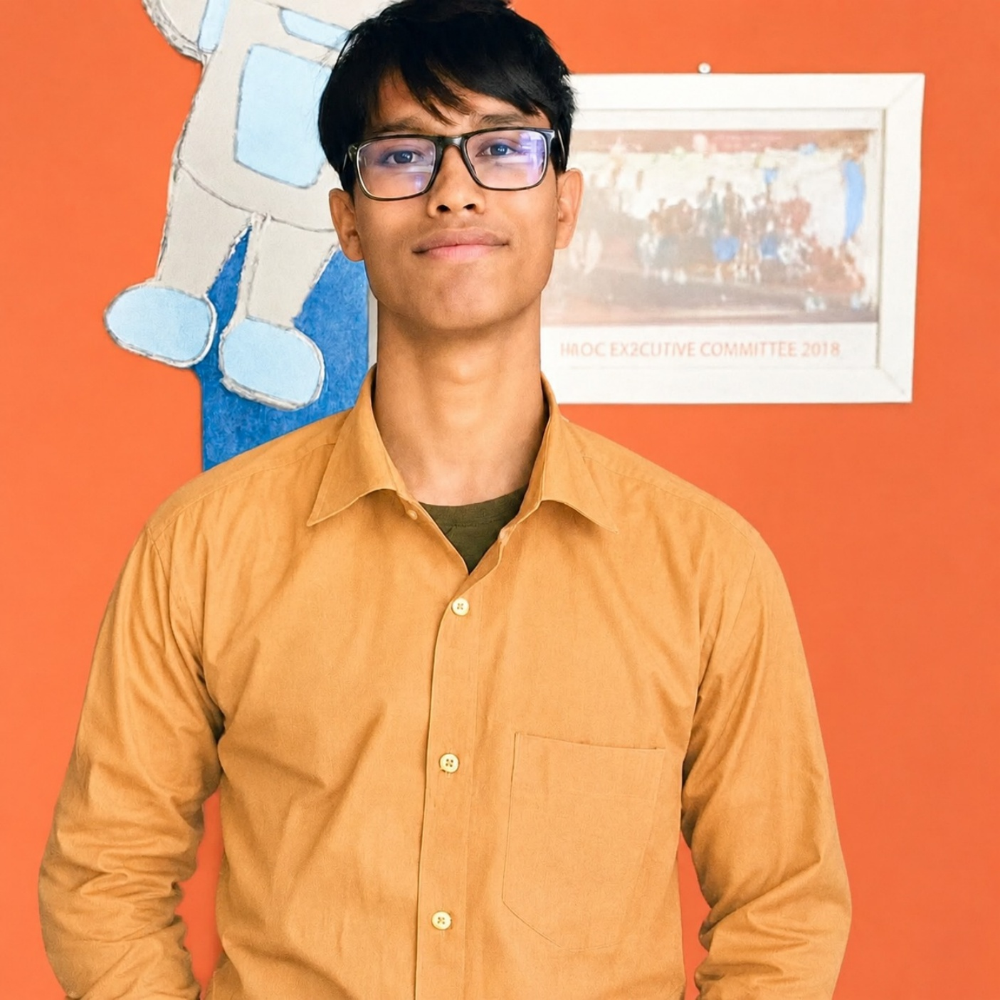

# Super Science & Technology Agency

**AI · Software Engineering · Cybersecurity · Data · Cloud · Research · Science · Deep Technology**

We design, build, secure, automate, and research technology solutions for startups, businesses, enterprises, institutions, and research organizations.

[Services](../SERVICES.md) · [Portfolio & demonstrations](#portfolio--demonstrations) · [Our team](#-our-team) · [Contact & collaboration](#contact--collaboration)

## At a glance

Super Science & Technology Agency works across software and AI engineering, cybersecurity, data and cloud platforms, research, and advanced technology. Engagements are scoped to requirements and available expertise; the service catalog describes areas of capability, not a claim that every service is always available or production-proven.

## Mission

Bring artificial intelligence, software engineering, data systems, cybersecurity, research, and platform engineering together to help organizations move from concept to resilient delivery. Our mission is to help ambitious teams turn complex technical ideas into useful, scalable, and secure outcomes.

## Vision

Help organizations design, build, secure, automate, and research the technology shaping the next wave of digital transformation.

## Core capabilities

- **AI & Machine Learning** — machine learning, generative AI, and agentic systems
- **Software & Digital Products** — web, mobile, enterprise software, and product engineering
- **Cybersecurity & Digital Trust** — application, cloud, network, and AI security
- **Data, Search & Knowledge** — data engineering, analytics, semantic search, and RAG
- **Cloud & Infrastructure** — cloud architecture, DevOps, platform engineering, and reliability
- **Research & Deep Technology** — scientific computing and emerging technology
- **Robotics & Embedded Systems** — robotics, IoT, edge computing, and embedded engineering
- **Product & Automation** — product design, business automation, and engineering operations

These are high-level groupings, not a replacement for the [complete 35-category services catalog](../SERVICES.md).

## Services directory

Explore the [complete service catalog](../SERVICES.md), with all 35 service categories, their listed capabilities, the industries they may apply to, and five engagement models.

## Industries we serve

These are application sectors for our capabilities, not separate technical service categories:

FinTech · HealthTech · MedTech · BioTech · PharmaTech · AgriTech · ClimateTech · EnergyTech · EdTech · LegalTech · PropTech · InsurTech · Supply Chain · Logistics · Automotive · Mobility · Telecom · Aerospace · Space · Industrial Technology · Smart Infrastructure · Smart Cities · Smart Buildings · Gaming · Creative Technology

## How clients can engage us

- **Strategy & Consulting** — technology strategy, feasibility, architecture, due diligence, transformation, and roadmaps.
- **Build & Deploy** — MVPs, SaaS, enterprise software, AI systems, mobile and web applications, and infrastructure.
- **Secure & Optimize** — cybersecurity, AI security, QA, performance, reliability, cloud optimization, and modernization.
- **Research & Innovation** — research experiments, prototypes, scientific AI, advanced AI, and emerging technology R&D.
- **Managed Engineering** — dedicated teams, team extension, maintenance, infrastructure, security, and technical leadership.

## Portfolio & demonstrations

No verified client projects or portfolio demonstrations are currently presented in this repository. Project examples can be added when public evidence and appropriate permission are available.

The [public profile repository](https://github.com/superscienceandtechagency/.github) contains this organization profile and service documentation; it is not presented as a client project. Visit the [organization's public repositories](https://github.com/superscienceandtechagency?tab=repositories) to discover any published work.

## 👥 Our Team

Meet the people behind Super Science & Technology Agency.

The names and roles below reflect the agency's supplied team roster and do not verify current GitHub organization membership. Member names are not linked because profile URLs have not been confirmed.

<table>
  <tr>
    <td align="center" width="33%">
      
       <strong>MD. Yousuf Ali</strong>
       Founder &amp; Chief Developer
    </td>
    <td align="center" width="33%">
      
       <strong>Srijon Dey</strong>
       Co-Founder &amp; Senior Developer
       Cyber Security Specialist
    </td>
    <td align="center" width="33%">
      
       <strong>Sonjoy Das</strong>
       Co-Founder &amp; Senior Developer
       AI/ML Specialist
    </td>
  </tr>
  <tr>
    <td align="center">
      
       <strong>MD. Mahtab Ahmed Mahin</strong>
       Senior Developer
    </td>
    <td align="center">
      
       <strong>Shahriar Siyam</strong>
       Senior Developer
       Data Scientist Specialist
    </td>
    <td align="center">
      
       <strong>Sobuj Dev</strong>
       Senior Graphics &amp; UI/UX Designer
    </td>
  </tr>
  <tr>
    <td align="center">
      
       <strong>MD. Sheik Rafiwol Karim Rafi</strong>
       Intern
       NASA’26 Space Apps Project Member
    </td>
    <td align="center">
      
       <strong>Hridi Singha</strong>
       Intern
       NASA’26 Space Apps Project Member
    </td>
    <td align="center">
      
       <strong>Amran Uddin</strong>
       Intern
       NASA’26 Space Apps Project Member
    </td>
  </tr>
  <tr>
    <td align="center">
      
       <strong>Miss. Rini</strong>
       Intern
       NASA’26 Space Apps Project Member
    </td>
    <td align="center">
      
       <strong>Mahidul Haque</strong>
       Guest Developer
       Cyber Security Specialist
       Research Collaborator
    </td>
    <td align="center">
      
       <strong>MD ABDUL HAKIM SEYAM</strong>
       Marketing Lead
    </td>
  </tr>
  <tr>
    <td align="center">
      
       <strong>Muhammad Billal Khan</strong>
       Marketing Team Member
    </td>
    <td align="center">
      
       <strong>Arafat Hossain</strong>
       Marketing Team Member
    </td>
    <td align="center">
      
       <strong>Shoumik Islam</strong>
       Research Collaborator
    </td>
  </tr>
  <tr>
    <td align="center">
      
       <strong>Mufti Faiyaz</strong>
       Research Collaborator
    </td>
    <td align="center">
      
       <strong>Mahfujur Rahman</strong>
       Research Collaborator
    </td>
    <td align="center">
      
       <strong>Wahaj Rashid Arian</strong>
       Research Collaborator
    </td>
  </tr>
  <tr>
    <td align="center">
      
       <strong>Probal Datta</strong>
       Research Collaborator
    </td>
    <td align="center"></td>
    <td align="center"></td>
  </tr>
</table>

The supplied roster describes four members as NASA’26 Space Apps Project Members. This designation does not establish NASA employment, affiliation, endorsement, or any unlisted award.

---

*We work together to build innovative technology and meaningful digital solutions.*

## Quality, security & responsible engineering

Our intended working principles include:

- Establishing clear scope and requirements
- Using testing and documentation appropriate to the work
- Taking a security-aware approach to development
- Reporting assumptions, risks, and limitations honestly
- Reviewing licenses before reusing third-party code
- Handling credentials and client data responsibly

These principles are not claims of certification, formal compliance, or guaranteed outcomes.

## Open-source collaboration

This repository currently focuses on the agency profile and documentation. Documentation corrections and profile improvements may be proposed as described in [CONTRIBUTING.md](../CONTRIBUTING.md); acceptance is at the agency's discretion. No software development contribution process is implied.

## Contact & collaboration

For service details, start with the [services catalog](../SERVICES.md). For public information and published work, visit the [Super Science & Technology Agency GitHub organization](https://github.com/superscienceandtechagency). No separate business email or contact channel is published here.

---

Super Science & Technology Agency · [GitHub organization](https://github.com/superscienceandtechagency)
